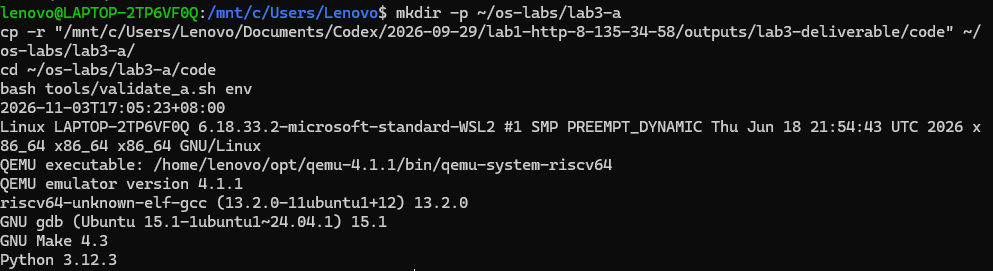
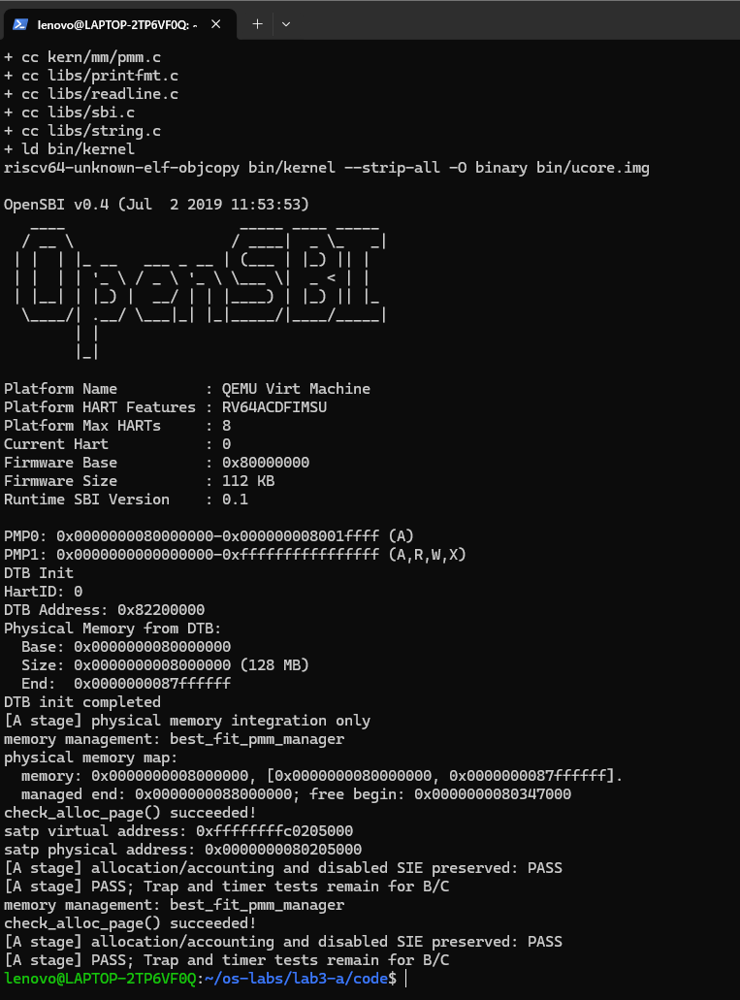

# 操作系统实验报告

本文为 A、B 阶段的合并稿，沿用课程模板的章节结构：A 阶段完成 Lab2 内存管理迁移与基础验证，B 阶段完成 Trap 入口与上下文恢复。C 阶段的中断/异常处理与最终评分待补；已完成结果按实际证据记录，未完成项明确标注，不把阶段结果当作完整实验成绩。

## 实验基本信息

| 项目 | 内容 |
|---|---|
| 实验名称 | Lab3：中断与异常处理 |
| 小组成员 | 2412101-张哲宇、2410683-刘梓涵、2411310-李熔吉 |
| 当前合并范围 | A 阶段：2412101-张哲宇；B 阶段：2410683-刘梓涵 |
| 代码与文档准备日期 | A 阶段 2026-11-03；B 阶段 2026-11-04；完整实验完成日期由 C 验收后填写 |

### 小组分工

A 先迁移内存管理基础与准备环境，交给 B；B 在此基础上完成 Trap 入口和上下文恢复，交给 C；C 完成中断异常处理、集成测试及报告合并，最后由 A 审核提交。各人分别提供本人章节与实际提示词，完整分工见随包的 `分工.md`。

## 一、实验目的

1. 在 Lab3 新框架中恢复物理内存初始化和 Best-Fit，建立后续 Trap 实验所需的基础。
2. 保留并理解内存分配路径上的中断保护，避免恢复旧代码时丢失新框架的同步机制。
3. 区分阶段验证与完整系统验收，提供可交接、可复现的基础版本。
4. 理解 Trap 发生时硬件保存的 CSR 与软件保存的通用寄存器，完成 Trap 入口与上下文恢复。
5. 推导 trapframe 的 36 个槽位，掌握恢复顺序、sp 最后恢复、`sret` 返回与 16 字节栈对齐。

## 二、实验环境

目标运行环境沿用本组 Lab2：WSL Ubuntu 24.04、源码编译的 QEMU 4.1.1、RISC-V 裸机交叉 GCC、GDB、GNU Make、Python 3。已核对本次环境截图：QEMU 4.1.1、交叉 GCC 13.2.0、GDB 15.1、Make 4.3、Python 3.12.3。环境截图显示命令运行时间为 2026-11-03，截图于 2026-11-04 归档；当前已归档两张目标环境截图，WSL 原始文本日志未出现在交付目录中。

| 成员 | AI 编程工具 | 底层模型 | 备注 |
|---|---|---|---|
| 张哲宇 | Codex 桌面应用 | 本次未核实具体型号 | 辅助代码迁移、边界复核与交接材料整理 |
| 刘梓涵 | DeepSeek Harness | DeepSeek-V4.1-Flash | 辅助 Trap 入口实现、汇编检查与临时桩验证 |
| 李熔吉 | 由本人补充 | 由本人补充 | C 阶段提供 |

开发侧已使用 Windows MSVC 和隔离的宿主测试适配层运行 Best-Fit 自检。该适配层没有模拟 RISC-V CSR、AMO 或中断，不作为目标环境测试通过的依据。

B 阶段在本机 WSL 环境复现：交叉 GCC 16.1.0（binutils 2.47），QEMU 同为 4.1.1；A 阶段截图中记录的是另一台机器的 GCC 13.2.0。最终统一环境表由 C 按完整验收环境整理。

## 三、实验整体逻辑分析

### 2.1 本章节的逻辑主线

Lab3 在已有内存支持上建立完整 Trap 处理链：先准备运行基础，再由汇编保存上下文并调用 C 处理函数，按原因分发中断和异常，最后恢复上下文并执行 `sret` 返回。时钟中断用于验证系统能够反复进入和退出处理流程。

A 阶段解决的是前置条件：DTB 已由 `dtb_init()` 解析，`pmm_init()` 选择管理器，再由 `page_init()` 建立 Page 描述符和初始空闲区。内存分配、释放和计数查询通过新框架的中断保护包装进入管理器。

### 2.2 功能的逐步实现

1. 从 Lab3 原始包开始，确认其中的 `lab2` 空缺以及新增同步代码。
2. 迁移 `page_init()`，使用当前头文件中的宏计算管理范围，保留初始化边界检查。
3. 迁移 Best-Fit 管理器，将原始测试保留在文件中，并在 `init_pmm_manager()` 选中它。
4. 保留 `alloc_pages()`、`free_pages()`、`nr_free_pages()` 的中断保护。
5. 先做静态与宿主逻辑检查，再在临时构建目录验证 A 阶段内核；B/C 完成后统一运行原始 `make grade`。
6. B 阶段在 A 版本上补齐 `trapentry.S`：`SAVE_ALL` 之后把 trapframe 指针传给 `trap`，返回后执行 `RESTORE_ALL` 与 `sret`；C 完成处理函数后统一运行原始评分。

启动汇编已在进入 C 代码前设置启动页表并启用 Sv39；`page_init()` 负责组织物理页，不负责首次开启分页。

## 四、实验内容与实现

### 前置模块：Lab2 内存管理迁移

**负责人：** 2412101-张哲宇。

**涉及函数：** `page_init()`、`init_pmm_manager()` 以及 Best-Fit 管理器的初始化、空闲区登记、分配、释放和统计函数。

#### 功能与 spec

输入是 DTB 给出的物理内存起点和大小，以及链接符号 `end`。成功后应设置 `va_pa_offset`、`npage`、`pages`，把排除保留空间后的完整空闲页面登记到 Best-Fit。

主要不变量如下：

- 当前启动映射要求物理内存从 `DRAM_BASE` 开始；零大小、加法溢出或不支持的起点触发 `panic()`。
- 管理上界取 DTB 末端与当前框架允许末端的较小值，并向下按页对齐。
- `npage` 是管理末端对应的物理页号；Page 描述符数量为 `npage - nbase`。
- 描述符在 `end` 之后按页对齐，写入前检查其整体能否放入管理区。
- 所有描述符先置为 Reserved；只有描述符数组之后、按页向上对齐的完整空闲页才交给 `init_memmap()`。
- 没有完整空闲页时不调用 `init_memmap()`；后续框架分配自检仍可能因无可用内存而失败，初始化不能凭空制造页面。

Lab3 未定义旧实现使用的 `KERNEL_BEGIN_PADDR`、`PHYSICAL_MEMORY_END`，因此采用：

```c
kernel_begin = KERNBASE - PHYSICAL_MEMORY_OFFSET;
memory_limit = KERNTOP - PHYSICAL_MEMORY_OFFSET;
```

当前框架下分别得到物理地址 `0x80200000` 和右开区间末端 `0x88000000`。这样沿用当前内存布局，不额外复制旧头文件。

Best-Fit 空闲链表按地址维护，分配时选择容量至少为 n 的最小块；精确匹配整块取出，较大块拆分，释放后尝试与前后相邻块合并。迁移时保留 Lab3 提供的 `basic_check()`、`best_fit_check()` 原文；代码注释同时注明本阶段集成人和 Lab2 分配器的原贡献者。

#### 最终实现约束与提示词记录

本阶段围绕“旧实现能否直接迁移”和“中断保护不能丢失”整理 spec，完整记录见 `prompt.md`。其中实现约束由本次代码核对形成，不冒充历史逐字对话。

关键约束是只补当前包的两处 `lab2` 空缺，选中 Best-Fit，保留同步包装、原始测试和 B/C 的待实现区域，不把旧 `pmm.c` 整文件覆盖到新框架。

#### 实现与核对过程

本阶段完成一轮迁移实现，随后核对修改范围并运行宿主 Best-Fit 自检，修复阶段验证依赖后完成 Ubuntu/QEMU 目标运行。已归档的截图显示 Best-Fit 自检、三页分配释放计数及关闭的 SIE 状态保持检查通过，程序返回 shell。

实际发现的兼容性差异是两个 Lab2 地址常量在 Lab3 缺失，以及新 `pmm.c` 的三个接口已加入中断保护。如果直接复制旧文件，会产生未定义宏，或使保护机制丢失。处理方式是按新宏推导地址边界，只插入初始化函数与管理器实现，保留框架包装原文。

未声称发生过目标 GCC 编译失败；上述问题是在代码核对阶段发现并处理。开发侧调用 Windows 编译器时还遇到一次命令引号错误，改用独立命令脚本后完成测试，该问题与内核逻辑无关。

首次 Ubuntu 阶段验证中，内存源文件已编译，但链接报 `kmonitor.c: undefined reference to print_trapframe`。原因是临时测试排除了 Trap 模块，却仍保留依赖其打印函数的交互监视器。修复后仅在临时副本中将监视器替换为 A 专用的报错停机端点，保留原始 `panic.c` 的诊断输出；若进入该端点，验证不能通过。正式监视器和 Trap 代码保持不变。重试后的目标运行截图确认阶段验证通过。

### 模块一：Trap 上下文恢复与入口

**负责人：** 2410683-刘梓涵。

**涉及文件：** `kern/trap/trapentry.S`（`RESTORE_ALL`、`__alltraps`）；`kern/trap/trap.h`（`struct trapframe`，未修改）；`kern/trap/trap.c` 的 `trap()`/`trap_dispatch()` 由框架提供，本阶段不修改。

#### 功能与 spec

`struct trapframe` 共 36 个 8 字节槽位，合计 288 字节（16 的倍数，满足 ABI 栈对齐）：

| 槽位 | 内容 | 槽位 | 内容 |
|---|---|---|---|
| 0 | x0/zero | 18–27 | s2–s11 |
| 1 | x1/ra | 28–31 | t3–t6 |
| 2 | x2/sp（原栈顶） | 32 | sstatus |
| 3 | x3/gp | 33 | sepc |
| 4 | x4/tp | 34 | sbadaddr/stval |
| 5–7 | t0–t2 | 35 | scause |
| 8–9 | s0–s1 | | |
| 10–17 | a0–a7 | | |

`SAVE_ALL`（框架原有，未修改）先 `csrw sscratch, sp` 暂存原 sp，再 `sp -= 36*8` 分配 trapframe；保存 x0、x1、x3～x31，并通过 `csrrw s0, sscratch, x0` 把原 sp 写入槽位 2；随后用 s1～s4 暂存并保存 `sstatus/sepc/sbadaddr/scause` 到槽位 32～35。`sscratch` 被清 0，用于识别内核态递归 Trap。

`RESTORE_ALL` 的实现顺序：

1. `LOAD s0, 32*REGBYTES(sp)`、`LOAD s1, 33*REGBYTES(sp)` 取出 `sstatus/sepc`，再 `csrw sstatus, s0`、`csrw sepc, s1`；CSR 写指令的源必须是通用寄存器，故需要临时寄存器，s0/s1 的原值稍后从槽位 8/9 恢复。
2. 恢复 x1、x3～x31；x0 恒为 0，无需恢复。
3. 最后恢复 x2/sp；所有槽位都相对 sp 寻址，提前恢复 sp 会使后续读取错位。
4. 落入 `__trapret` 执行 `sret`。

不恢复 `scause`/`stval`：它们是 Trap 原因与地址的诊断信息，不参与返回控制；返回 PC 与特权级由 `sepc`、`sstatus.SPP` 决定，`sret` 还会令 `SIE=SPIE`、`SPIE=1`、`SPP=0`。本实验主要返回 S 态，不能笼统写成每次 `sret` 都进入 U 态。

`__alltraps` 在 `SAVE_ALL` 后把当前 sp 放入 `a0`，调用 `trap(struct trapframe *tf)`；返回后 sp 仍指向同一 trapframe，继续落入 `__trapret`。`jal trap` 会改写 x1/ra，但原 x1 已保存在槽位 1，`RESTORE_ALL` 会恢复，不影响原执行流。

#### 最终提示词

以下为根据本次开发整理的任务规格（不是逐字聊天记录）：

```text
输入：Lab3 代码包的 kern/trap/trapentry.S、kern/trap/trap.h；SAVE_ALL 已实现，
      struct trapframe 已定义；A 阶段已完成内存管理迁移。
任务：补齐 RESTORE_ALL 与 __alltraps 中的调用逻辑，保留 lab3 function1 标记，
      将 YOUR CODE 换成 2410683。
要求：
1. 保持 SAVE_ALL、struct trapframe、__alltraps/__trapret 边界不变。
2. 推导 36 个槽位：x0..x31 在 0..31，sstatus/sepc/badvaddr/scause 在 32..35，
   共 36*8=288 字节，满足 16 字节栈对齐。
3. RESTORE_ALL 先用 s0/s1 读 sstatus/sepc 并 csrw，再恢复 x1、x3..x31，
   最后恢复 x2/sp。
4. 不恢复 scause/stval 等诊断 CSR；说明 sret 依据 sstatus.SPP/SPIE 与 sepc 返回。
5. __alltraps：mv a0, sp；jal trap；返回后 sp 不变并落入 __trapret。
6. 不修改 trap.c 分发逻辑和 C 的处理函数，不修改 A 的内存管理代码。
判据：汇编通过；槽位偏移与结构体一致；临时桩下 Test 1 寄存器上下文检查通过；
      不把临时桩结果冒充最终 make grade。
```

#### 实现迭代过程

**第 1 次迭代：按 SAVE_ALL 反推恢复顺序。** 先列 36 个槽位的保存来源，再确定两个约束：CSR 写需要通用寄存器中转，故用 s0/s1 暂存 `sstatus/sepc`；x2/sp 必须最后恢复。实现后汇编通过，`objdump` 确认 CSR 写在 GPR 恢复之前、`ld sp, 16(sp)` 在最后。

**第 2 次迭代：工具链旧 CSR 名称兼容。** 本机 binutils 2.47 不再识别 `SAVE_ALL` 中的 RISC-V 1.9 旧名 `sbadaddr`（1.10 起为 `stval`，0x143），汇编报错。为保持 `SAVE_ALL` 原文不变，在文件开头加 `.equ sbadaddr, 0x143`；旧工具链即使仍识别旧名也不改变语义。

**第 3 次迭代：临时桩验证入口与恢复路径。** C 的处理函数尚未实现，因此在不进入仓库的临时副本 `~/lab3-b-test` 中放临时处理函数（断点异常前移 EPC），用 `tools/inject.py` 注入 Test 1 并构建运行。第一次得到 `FAIL (register context)`：排查发现不是 `RESTORE_ALL` 的问题，而是测试里的 `ebreak` 被汇编为 2 字节 `c.ebreak`（objdump 显示 `9002`），临时桩按 4 字节前移跳过了下一条指令；临时桩改为 `+2` 后得到 PASS。正式处理函数必须按实际指令长度判断 16/32 位，不能统一 `+4`。

#### 验证与交接

- 汇编检查：`riscv64-unknown-elf-gcc -mcmodel=medany -std=gnu99 -Werror -nostdinc -Ilibs -Ikern/trap -c kern/trap/trapentry.S` 通过（日志 `logs/b-stage-assembly-check.log`）。
- 反汇编：`__trapret` 中 `ld s0,256(sp)`、`ld s1,264(sp)`、`csrw sstatus,s0`、`csrw sepc,s1`，恢复 GPR 后 `ld sp,16(sp)`、`sret`；`__alltraps` 中 `mv a0, sp`、`jal trap`。
- 临时桩 Test 1：`[Test 1] Trap entry and breakpoint return: PASS (35/35)`（日志 `logs/b-stage-context-stub.log`）。该结果使用临时桩处理函数，只证明入口/恢复路径，不是最终 `make grade`；Test 2/3 与满分评分待 C 完成处理函数后统一验证。
- 交接 C：实现 `interrupt_handler`/`exception_handler`，处理时钟、非法指令、断点与兜底输出；EPC 前移按 16/32 位指令解码；完成时钟重设、ticks、100 ticks 与关机条件，最后运行正式 `make grade` 并区分临时桩与正式结果。

### 中断保护分析

`local_intr_save(flag)` 保存当前 SIE 状态并在原先开启时关中断；操作完成后，`local_intr_restore(flag)` 仅在原先开启的情况下恢复开启。这样在本来已关闭中断的调用环境中，不会错误地把中断打开，也支持遵守此约定的嵌套临界区。

`do { ... } while (0)` 使多语句宏在调用处表现为一条语句，适合放在 `if/else` 中使用，并允许常规结尾分号。

本框架 `atomic.h` 用 RISC-V AMO 指令实现位更新；它保证特定内存操作的原子性。局部关中断保护的是当前 hart 上一段操作期间不被可屏蔽中断打断。两者作用范围不同，不能互相替代，更不能据此声称链表操作已具备多核互斥。`volatile` 只约束相关访问优化，本身不提供锁或复合操作原子性。

## 五、测试与验证

| 检查 | 当前状态 | 证据与边界 |
|---|---|---|
| 原包文件修改范围 | 通过 | `logs/a-static-check.log`，原始文件仅两个内存文件变化 |
| 原始 Best-Fit 两个测试函数未改 | 通过 | 同一静态核对日志，比较完整测试区段 |
| 三个接口的关中断包装未改 | 通过 | 同一静态核对日志，逐段比较 |
| Best-Fit 宿主逻辑自检 | 通过 | `logs/a-native-best-fit.log`，Windows 测试适配层，非 RISC-V 执行 |
| A 阶段目标编译和启动 | 通过 | `images/lab3_a_check.png`，含链接、镜像生成、Best-Fit 自检、阶段 PASS 和返回 shell |
| Lab3 原始评分与自动时钟关机 | B/C 完成后验收 | 由 C 运行，不能填写推测分数 |
| B 阶段 trapentry.S 汇编检查 | 通过 | `logs/b-stage-assembly-check.log`，含 `__alltraps`/`__trapret` 关键反汇编 |
| B 阶段临时桩 Test 1 | PASS 35/35（临时桩，不是最终评分） | `logs/b-stage-context-stub.log`；C 的处理函数尚未实现 |

`validate_a.sh check` 复制代码到新建的临时目录，使用 A 专用入口，并在该临时构建中排除未实现的 Trap 模块。测试调用真实 `pmm_init()` 与 Best-Fit 自检，再验证三页分配/释放后的计数和原先关闭的 SIE 状态，最后通过 SBI 关机。

临时副本同时使用 A 专用的监视器报错端点，避免原交互监视器依赖 Trap 打印函数。它输出失败信息后停止，不提供交互命令；原始 panic 诊断保留，失败由超时、错误检测或缺少 PASS 标志判定。

它不验证已开启 SIE 的完整中断流程，也不替代 B/C 的寄存器恢复、异常、定时器与原始评分。正式 `kern/init/init.c`、Makefile、Trap 源码和评分文件不因该脚本被修改。

B 阶段在 A 版本上补齐了 `trapentry.S` 的 `RESTORE_ALL` 与 `__alltraps` 调用；汇编与反汇编确认 36 个槽位的偏移、CSR 恢复顺序和 sp 最后恢复。由于 C 的两个处理函数尚未实现，正式内核还不能完整链接；B 在临时副本中用处理函数桩运行注入的 Test 1，得到 35/35，该结果只证明入口与恢复路径，不能替代最终 `make grade`，也不能替代 C 对 Test 2/3 的验收。

本次启动截图中的 DTB 内存范围为 `[0x80000000, 0x88000000)`（128 MiB），管理末端为 `0x88000000`，空闲区起点为 `0x80347000`；启动页表虚拟地址为 `0xffffffffc0205000`，物理地址为 `0x80205000`。这些是 A 专用入口版本的实测值，B/C 增加代码后地址可能变化。





## 六、实验总结与收获

### 对操作系统的理解

本阶段的 Page 描述符对应 OS 原理中的物理页元数据，Best-Fit 对应连续空间分配策略；实际代码还必须处理保留区、地址转换、页对齐与空闲块不变量。临界区保护对应并发访问控制，但单 hart 关中断并不等于多处理器同步。

B 阶段补充：Trap 的保存范围不能只按普通函数的 caller/callee-saved 划分，必须保存全部通用寄存器和返回所需的 `sstatus`/`sepc`；恢复顺序由 trapframe 以 sp 为基址这一事实决定，因此 sp 必须最后恢复。`sret` 的返回 PC 与特权级分别由 `sepc` 和 `sstatus.SPP` 决定，`SIE/SPIE` 的恢复也与中断状态相关。

B 已完成上下文保存与返回路径；C 还需补齐同步异常、异步中断与完整评分。本实验尚未覆盖完整进程调度、用户态系统调用、完整缺页恢复、多核锁和生产系统中的设备驱动中断确认流程，不能把本实验的简化处理等同于这些完整机制。

### AI 协作开发的经验

迁移前先比较新旧框架，比直接请求“复制 Lab2 代码”更有针对性。把“哪些区域可以改、哪些接口和测试必须保留”写成约束，再用文件和区段比较检查生成结果，可以发现误覆盖。AI 能协助整理实现与解释，但目标平台运行结果仍应通过实际编译和测试取得。
