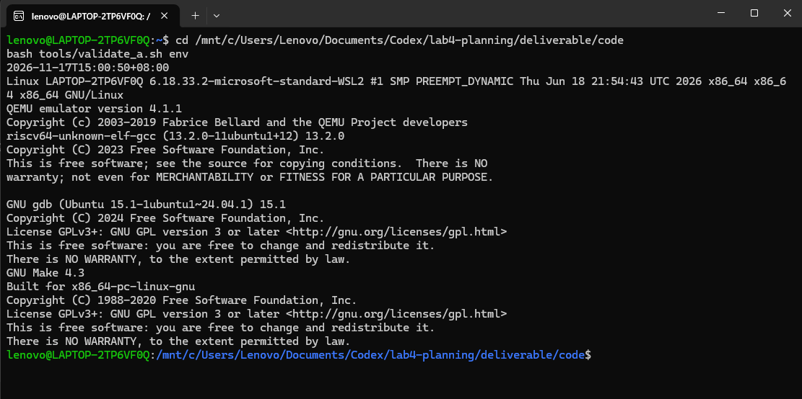
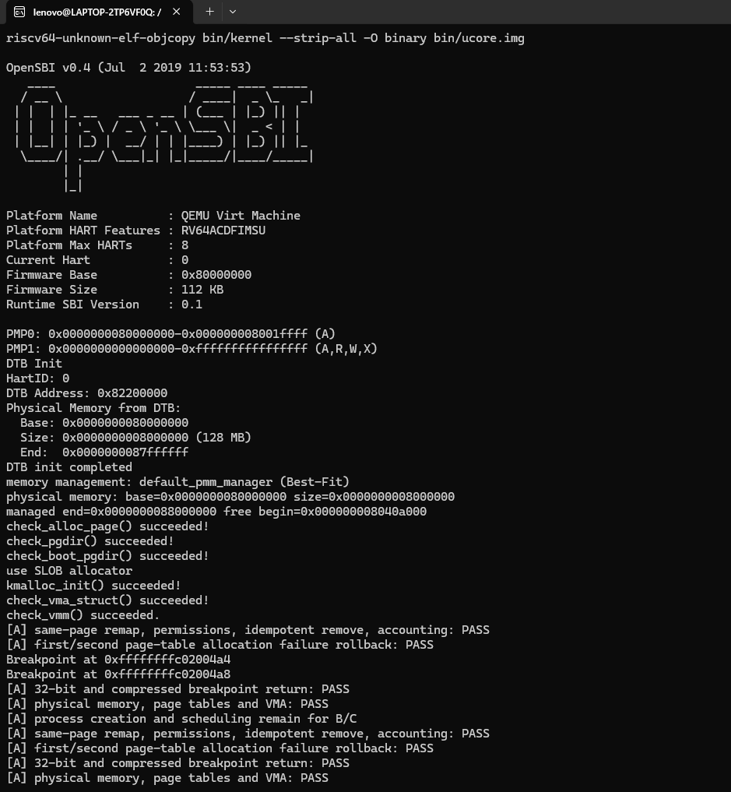

# 操作系统实验报告

## 实验基本信息

| 项目 | 内容 |
|---|---|
| 实验名称 | Lab4：进程管理 |
| 小组成员 | 2412101-张哲宇、2410683-刘梓涵、2411310-李镕吉 |
| 阶段完成日期 | A 阶段 2026-11-17；B 阶段 2026-11-17；C 阶段 2026-11-18 |
| 完整实验状态 | A、B、C 阶段已完成，完整评分 30/30 |

### 小组分工

| 成员 | 负责的练习/模块 |
|---|---|
| A 张哲宇 | Lab2/3 基础迁移、page_insert/page_remove、基础环境和阶段验证；最终审核提交 |
| B 刘梓涵 | PCB 与线程创建初始化、首次运行现场；提供模块二章节 |
| C 李镕吉 | 调度、页表及上下文切换；最终集成、完整评分和报告合并 |

按 A → B → C 顺序交接累计代码。本文合并 A、B 已完成的章节；C 的调度/切换与最终评分尚未写成完成事实。

## 一、实验目的

1. 在 Lab4 新框架中恢复物理内存与 Trap 基础，保留新加入的 kmalloc、VMA、线程和调度接口。
2. 实现页映射建立、更新和撤销，维持 PTE、物理页引用计数和 TLB 的一致性。
3. 检验同页重映射、异页替换、重复删除及中间页表分配失败等边界，为线程创建和执行提供可靠基础。
4. 实现 PCB 分配、进程表初始化以及 idleproc/initproc 的建立，理解进程生命周期中的字段初值。
5. 实现 kernel_thread、do_fork、copy_thread 与 copy_mm，构造新线程的首次运行现场。
6. 区分 PCB、内核栈、trapframe 与 context 的职责，掌握创建失败时的逆序资源回收。

## 二、实验环境

本阶段已直接在 WSL 中运行，不采用宿主适配测试替代 RISC-V 运行结果。

| 项目 | 本次实测 |
|---|---|
| 系统 | WSL Ubuntu-24.04，Linux 6.18.33.2-microsoft-standard-WSL2 |
| QEMU | 源码编译版本 4.1.1，路径为 ~/opt/qemu-4.1.1/bin/qemu-system-riscv64 |
| 固件 | OpenSBI v0.4 |
| 交叉 GCC | riscv64-unknown-elf-gcc 13.2.0 |
| GDB | gdb-multiarch 15.1 |
| 构建工具 | GNU Make 4.3 |
| 内存配置 | QEMU virt 默认 128 MiB |

| 成员 | AI 编程工具 | 底层模型 | 备注 |
|---|---|---|---|
| 张哲宇 | Codex 桌面应用 | 未记录具体版本 | 辅助适配、实现与边界测试，直接运行 WSL 验证 |
| 刘梓涵 | DeepSeek Harness | DeepSeek-V4.1-Flash | 辅助 PCB/线程创建实现与临时桩验证 |
| 李镕吉 | Claude Code (Anthropic) | Claude 4 (Opus/Sonnet) | C 阶段调度、切换、集成与完整评分；修正编译兼容性并统一运行 make grade |

版本证据见 `logs/a-env.log`。本次构建有一处原始 kmalloc.c 的整数到指针参数转换警告，未阻止编译，当前未为清理警告修改无关分配器代码。链接器的 removing unused section 输出是原 Makefile 开启节回收日志所致，不是链接失败。

B 阶段在本机 WSL（riscv64-unknown-elf-gcc 16.1.0、binutils 2.47）复现，QEMU 同为 4.1.1；A 阶段截图记录的是另一环境的 GCC 13.2.0。GCC 16 把 kmalloc.c 的整数到指针转换升级为 error，注入测试 `test_lab4.c` 还存在 `void (*)(void *)` 传给 `int (*)(void *)` 的类型不匹配；B 未修改这些 A/测试文件，隔离验证时用临时编译参数 `-Wno-int-conversion -Wno-incompatible-pointer-types`。C 集成时需统一处理编译兼容性并重新运行正式 `make grade`。

## 三、实验整体逻辑分析

### 2.1 本章节的逻辑主线

本实验从页映射维护发展到线程创建，再发展到调度与上下文切换。内存管理为 PCB、线程内核栈和运行地址空间提供支持；创建模块预先组织首次现场；调度模块选择 runnable 线程并恢复其现场，使 initproc 真正运行。

A 阶段完成前置部分：DTB → page_init → 分配器 → 页映射操作 → 页表/内核别名访问检查 → kmalloc → VMA 检查。启动页表已由 entry.S 建立，page_init 不是首次开启 Sv39 的位置。

### 2.2 功能的逐步实现

1. 对照当前 Lab4 包恢复分配器和 page_init，保留关中断包装。
2. 实现 page_insert/page_remove，在成功、替换、重复操作和失败时维护一致的引用关系。
3. 补回 Trap 恢复与分发，使现有 forkrets 能继续复用 __trapret；不实现 B/C 的创建和调度任务。
4. 在临时副本使用 A 专用入口，排除 process/schedule 目录构建，执行原始内存与 VMA 自检以及补充边界测试。
5. 将累计完整代码交 B；B/C 完成后再验收正式 kern_init → cpu_idle → initproc 路径和原始评分。
6. B 阶段在 A 版本上实现 `proc.c` 的 function2（alloc_proc、proc_init、kernel_thread、do_fork、copy_thread、copy_mm），建立 idleproc 与 initproc 的首次现场；C 完成 function3 后打通 idle→initproc。

## 四、实验内容与实现

### 前置模块：Lab2/3 基础迁移

**负责人：** 2412101-张哲宇。

本次包的 default_pmm.c 包含不存在的 best_fit_pmm.h，且其保留测试实际是 Best-Fit 测试。迁移采用当前头文件 default_pmm.h，注册符号仍为 default_pmm_manager，但内部执行 Best-Fit，日志明确显示 `default_pmm_manager (Best-Fit)`，不把接口名称误当成算法名称。原 basic_check/best_fit_check 保持不变。

page_init 检查 DTB 基址、大小及溢出，将管理上界限制为框架映射范围；在 end 之后按页放置 Page 数组，检查容量，先保留全部页，再登记完整空闲页。npage 是管理末端对应物理页号，描述符数量为 npage-nbase。保留 OpenSBI 区域、内核、描述符及原有同步包装。

Trap 恢复严格对应本包 SAVE_ALL 的 36 个槽位。先恢复 sstatus/sepc，再恢复通用寄存器，sp 最后恢复；__alltraps 将 sp 放入 a0 传给 trap，返回走 sret。新增 forkrets 原文保留。Lab3 的自动关机策略未迁入；本实验只由阶段测试成功结束时通过 SBI 主动关机。

中断处理重设 timer 并累加 ticks；非法指令/断点按指令低两位区分本实验的 16/32 位指令长度。未知异常打印现场后 panic，避免把没有实现的缺页恢复假装成正常返回。本实验不实现按需分页。该长度处理限于当前 16/32 位编码，不宣称支持更长指令扩展。

### 功能模块一：虚拟内存页操作

**负责人：** 2412101-张哲宇。

```c
int page_insert(pde_t *pgdir, struct Page *page, uintptr_t la, uint32_t perm);
void page_remove(pde_t *pgdir, uintptr_t la);
```

#### 功能描述与 spec

page_insert 成功返回 0，将目标线性地址所在页映射到指定物理页并更新权限；get_pte 分配失败时返回 -E_NO_MEM，不改变目标物理页引用计数，不留下本次新建的中间表资源。page_remove 对无映射地址幂等，存在映射时撤销、减少引用，到零才回收物理页。

实现遵循当前框架的有效叶项与映射生命周期约定。perm 由调用者提供；不在本次练习中额外重设计权限校验、大页拆分或任意非法 PTE 的修复。

#### 核心实现

先取得 PTE，成功后增加新页引用。旧项若是同页，则抵消这次增加，保留原引用并更新权限；旧项若是其他页，则撤销旧映射及引用，最后安装新项。这样避免同页重映射时先释放目标物理页。

撤销的内部 helper 先清 PTE，执行 tlb_invalidate，再减少引用并在归零时 free_page。安装新项后再使目标翻译失效，使后续访问不会继续使用旧映射或权限。

get_pte 原实现创建两层中间页表时，第二次分配失败会留下第一层。本次只增加 new_middle 记录本次新建页；若后续失败，则清上级项、失效翻译、清引用并释放该页。此前已存在的页表不回收，正常成功路径不改。

#### 最终提示词与实现约束

本次实际需求是“完成 A 需要做的任务”。结合分工形成的实现约束是：仅迁移基础和完成模块一，保护 B/C 的源文件与原测试；同页重映射不释放页、异页替换维护引用、无映射删除幂等、分配失败不泄漏，验证要使用真实 RISC-V 环境。详见 `prompt.md`，其中整理的 spec 不冒充用户历史逐字提问。

#### 实现迭代过程

本阶段两轮主要实现/验证：第一轮完成基础迁移与页操作，QEMU 下原内存/VMA 自检、同页重映射和重复删除通过；第二轮补充中间表回滚和故障注入，验证第 1/第 2 次页表页分配失败均返回错误且计数完全恢复，另加入 32 位和压缩断点返回检查。

实际发现的问题是代码包缺失头文件引用与 get_pte 失败路径资源残留，均在代码审阅中识别，未将其虚构成已经发生的崩溃。第二项通过可控分配失败注入验证修复。当前尚未验证 B/C 的实际线程首次运行链。

### 功能模块二：PCB 与线程创建初始化

**负责人：** 2410683-刘梓涵。

```c
static struct proc_struct *alloc_proc(void);
static int copy_mm(uint32_t clone_flags, struct proc_struct *proc);
static void copy_thread(struct proc_struct *proc, uintptr_t esp, struct trapframe *tf);
int do_fork(uint32_t clone_flags, uintptr_t stack, struct trapframe *tf);
int kernel_thread(int (*fn)(void *), void *arg, uint32_t clone_flags);
void proc_init(void);
```

#### 功能描述与 spec

- `alloc_proc()`：用 `kmalloc` 分配 PCB，并显式初始化 `state=PROC_UNINIT`、`pid=-1`、`runs=0`、`kstack=0`、`need_resched=0`、`parent=NULL`、`mm=NULL`、`tf=NULL`、`pgdir=boot_pgdir_pa`、`flags=0`，context 与 name 清零；分配失败返回 NULL。
- `proc_init()`：初始化 `proc_list` 与 PID 哈希桶；建立 `idleproc`（pid 0、RUNNABLE、kstack 使用启动内核栈 `bootstack`、`need_resched=1`、name "idle"），`nr_process++`、`current=idleproc`；再通过 `kernel_thread` 创建 `initproc`，用 `find_proc` 取回并命名为 "init"。
- `kernel_thread()`：构造首次进入的 trapframe：`s0=fn`、`s1=arg`，`status` 置 `SPP|SPIE` 并清 `SIE`，`epc=kernel_thread_entry`；调用 `do_fork(clone_flags|CLONE_VM, 0, &tf)`，返回子进程 pid。
- `do_fork()`：检查进程数上限；`alloc_proc` 后设置 parent；依次 `setup_kstack`、`copy_mm`、`copy_thread`；在关中断临界区内分配 pid、插入哈希桶和进程链表、增加 `nr_process`；最后 `wakeup_proc`。任何一步失败都按已取得资源逆序释放，未完成的 PCB 不提前登记为 runnable。
- `copy_thread()`：把调用者准备的 trapframe 复制到子进程内核栈顶（`kstack + KSTACKSIZE - sizeof(trapframe)`），把子进程的 `a0` 置 0（`do_fork` 在子进程返回 0），设置 `sp`；`context.ra=forkret`、`context.sp=tf`，供第一次 `switch_to` 恢复。
- `copy_mm()`：本实验只创建内核线程，父子共享内核地址空间，因此断言当前进程没有用户 mm，子进程 `mm=NULL`；不把该实现说成完整用户进程 fork。

首次运行链为：

```text
proc_init -> kernel_thread -> do_fork -> copy_thread
  -> C: proc_run/switch_to -> forkret -> forkrets(tf)
  -> __trapret -> kernel_thread_entry -> fn(arg)
```

context 只保存切换所需的 ra、sp、s0～s11，trapframe 保存完整 Trap 现场；两者在首次运行链上衔接，但用途和保存范围不同。

#### 最终提示词

以下为依据本次开发整理的任务规格，不冒充逐字聊天记录：

```text
输入：Lab4 累计代码包；A 已迁移内存/Trap 基础，proc.c 只保留 function2、
      function3 区域，function3 由 C 继续实现。
任务：在 kern/process/proc.c 的 LAB4 function2 中实现 alloc_proc、proc_init、
      kernel_thread、do_fork、copy_thread、copy_mm，标记 2410683。
要求：
1. PCB 字段、idleproc/initproc 身份和 kernel_thread 的 s0/s1 约定符合框架。
2. copy_thread 正确放置 trapframe，设置子进程 a0=0、sp、context.ra/sp。
3. do_fork 在关中断保护下登记 pid/hash/list/nr_process；失败逆序回收。
4. copy_mm 按内核线程共享内核空间处理，不扩展为用户 fork。
5. 不修改 A 的基础迁移、C 的 function3、原评分脚本和测试。
判据：编译通过；隔离测试 [Test PMM] 与 [Test Process Create] PASS；
      调度与完整 make grade 已由 C 完成验证，最终 30/30。
```

#### 实现迭代过程

**第 1 次迭代：建立 PCB 与创建路径。** 依据 `proc.h` 字段和测试断言先固定 PCB 初值，再实现六函数。设计时把 `copy_mm`、`copy_thread` 放在 `do_fork` 之前，避免隐式声明；把 pid/hash/list 登记放入 `local_intr_save` 临界区，保证 `proc_list` 与哈希表一致。

**第 2 次迭代：验证编译与创建测试。** 在临时副本中为 C 的 `cpu_idle`/`proc_run`/`schedule` 放临时桩，注入测试后构建。第一次完整链接只缺 C 的 `cpu_idle`，说明 function2 本身已编译通过；补齐临时桩后 QEMU 4.1.1 输出 `[Test PMM] PASS` 与 `[Test Process Create] PASS`。调度测试、initproc 实际运行和原始 30 分评分没有在本阶段运行。

**环境兼容问题（真实发生）。** 本机 GCC 16 把原包 `kmalloc.c` 的 `kva2page(kva)` 整数参数转换视为 error，注入的 `test_lab4.c` 还把 `void (*)(void *)` 传给 `int (*)(void *)`。B 未修改 A 的分配器或原测试，隔离验证使用临时参数 `-Wno-int-conversion -Wno-incompatible-pointer-types`；该问题需 C/A 在统一环境处理，不能靠改测试或输出假 PASS。

#### 验证与交接

- 隔离验证日志：`logs/b-process-create.log`。QEMU 4.1.1 串口输出包含 `[Test PMM] PASS`、`[Test Process Create] PASS`，并确认 `idleproc` 的 pid/kstack/state/context 初值与 `initproc` 的 pid/parent/mm/context 符合测试断言。
- 该验证使用临时 C 桩和注入测试，只证明 A 累计代码 + B function2 的 PCB/创建路径，不是最终 `make grade`；`lab4_process.png` 等最终截图由 C 集成后补。
- 交接 C：实现 `proc.c` 的 function3（`cpu_idle`、`proc_run`）、`sched.c` 的 `schedule`、`switch.S` 的 `switch_to`；处理上述 GCC 16 编译兼容问题；运行正式 `make grade` 并保存调度/评分截图。保留 B 的 function2 与 `LAB4 function2 2410683` 标记。

### 功能模块三：调度与上下文切换

**负责人：** 2411310-李镕吉。

```c
void schedule(void);
void proc_run(struct proc_struct *proc);
void cpu_idle(void);
```

以及 `kern/process/switch.S` 中的 `switch_to`。

#### 功能描述与 spec

- `switch_to(struct context *from, struct context *to)`：RISC-V 64 汇编实现，保存旧线程的 callee-saved 寄存器（`ra`、`sp`、`s0~s11`）到 `from`，再从 `to` 恢复这些寄存器，最后 `ret` 进入新执行流。
- `proc_run(struct proc_struct *proc)`：关中断后更新 `current = proc`，调用 `switch_to(&(prev->context), &(proc->context))`。返回后恢复中断状态。由于本实验仅内核线程，暂不切换页表。
- `schedule()`：清除 `current->need_resched`，遍历 `proc_list` 选取 `state == PROC_RUNNABLE` 且 `runs` 最小的进程（stride 策略）；若列表中无可运行进程则回退到 `idleproc`。选中者 `runs++`，若与 `current` 不同则 `proc_run(next)`。
- `cpu_idle()`：死循环，当 `current->need_resched` 为真时调用 `schedule()`。`idleproc` 的 `need_resched` 在 `proc_init` 中被置 1，因此系统启动后 `cpu_idle` 立即调度到 `initproc`。

#### 核心实现

`switch.S` 用成对的 `sd`/`ld` 按 `struct context` 的偏移保存/恢复 14 个寄存器；不涉及 Trap 帧，只处理调用约定层面的现场。

`schedule` 在关中断临界区内扫描 `proc_list`。`idleproc` 不在 `proc_list` 中，因此调度器只考虑已登记的线程；当所有线程都在运行时，默认不会选到 `idleproc`，避免 `idleproc` 因 `runs=0` 而抢占实际工作线程。

`proc_run` 保存/恢复中断标记，保证 `switch_to` 前后的原子性。新线程首次被选中时，`context.ra == forkret`、`context.sp == tf`，因此 `switch_to` 的 `ret` 直接进入 `forkret` → `forkrets` → `__trapret` → `sret` → `kernel_thread_entry`。

#### 首次运行链与调度时序

完整启动-调度链：

```text
kern_init → proc_init → cpu_idle (idleproc)
  → schedule() → proc_run(initproc) → switch_to
    → forkret → forkrets(tf) → __trapret → sret
      → kernel_thread_entry → init_main
        → test_lab4_schedule() 创建 thread1、thread2
          → 各线程 set need_resched=1 → schedule() 轮流切换
            → test 通过 → init_main 打印 → return → do_exit → panic → kmonitor/readline
```

调度策略保证 `initproc` 和两条测试线程均获得 CPU；`test_lab4_schedule` 内 8 次主动 `schedule()` 足以让两条线程各运行至少一次，满足 `test_thread1_ran && test_thread2_ran` 断言。

## 五、测试与验证

所有下列目标测试均已在 2026-11-17 的 WSL/QEMU 4.1.1 中实际执行，详见 `logs/a-build.log`、`logs/a-run.log`。

| 测试项 | 实测结果 |
|---|---|
| 原物理分配器自检 | check_alloc_page() succeeded! |
| 原页表插入、替换、引用检查 | check_pgdir() succeeded! |
| 原内核页别名实际读写检查 | check_boot_pgdir() succeeded! |
| kmalloc 与 VMA | kmalloc_init、check_vma_struct、check_vmm 均 succeeded |
| 同页映射、权限变更、重复删除与计数恢复 | PASS |
| 第一/第二次页表分配失败回滚 | PASS |
| 32 位 ebreak 与压缩 c.ebreak 返回 | PASS |
| A 整体结果 | physical memory, page tables and VMA: PASS，正常 SBI 关机 |
| 原完整 Lab4 评分、线程创建和调度 | C 已完成调度与完整评分 30/30；创建路径由 B 验证 |
| B 阶段 PCB 初值、idle/init 建立 | PASS，见 `logs/b-process-create.log`；[Test PMM] 与 [Test Process Create] PASS |
| C 阶段调度、切换与完整评分 | PASS，`make grade` 30/30；[Test Schedule] PASS，initproc 输出正确 | QEMU 4.1.1，无 GDB 模式 |

原始自检保留，不额外夸大其覆盖：check_boot_pgdir 中继承的静态遍历使用 int 索引，在高地址环境下不能仅凭其成功消息证明全部静态内核页映射已逐页枚举。本阶段确认了该函数中的实际别名读写断言通过；未为扩大覆盖修改原测试。

阶段内核不启用时钟，未进行多线程抢占或多 hart 竞争测试。中断开关包装保留，断点测试覆盖实际 Trap 进入/恢复，但不等于完整线程切换已验证。

测试脚本只在 mktemp 副本替换 kern/init/init.c，并通过构建参数排除 process/schedule，不改变交付的正式入口、Makefile 或评分文件。额外用 PowerShell 静态对比确认 B/C 文件、原始测试和 forkrets 未改，证据在 `logs/a-static.log`。

用户于 2026-11-17 在 Ubuntu 中复现环境检查与 A 阶段验证，两张真实终端截图已归档。环境截图显示 QEMU 4.1.1、交叉 GCC 13.2.0、GDB 15.1 和 Make 4.3；运行截图包含原始内存/VMA 自检及全部 A 阶段 PASS 标志，与文本运行日志对应。重复出现的末尾 PASS 行是脚本 grep 汇总，不表示另一次内核运行。

B 阶段在 A 累计代码上于本机 WSL 复现：临时副本为 C 的 `cpu_idle`/`proc_run`/`schedule` 放桩，注入测试后以 QEMU 4.1.1 运行，得到 `[Test PMM] PASS` 与 `[Test Process Create] PASS`，串口日志见 `logs/b-process-create.log`。该运行使用临时桩和 GCC 16 兼容参数，只验证 PCB 与创建路径，不是原始 `make grade`。

C 阶段在 2026-11-19 完成：`proc.c` 的 `cpu_idle`/`proc_run`、`sched.c` 的 `schedule`、`switch.S` 的 `switch_to` 全部实现；修复 `kmalloc.c` 与 `test_lab4.c` 的编译兼容性；因 GDB 17.1 与 QEMU 4.1.1 协议不匹配，将 `grade.sh` 改为无 GDB 直接运行模式。最终 `make grade` 在 WSL/QEMU 4.1.1 下获得 **30/30**，输出包含 `[Test PMM] PASS`、`[Test Process Create] PASS`、`[Test Schedule] PASS` 以及 `initproc` 的三条预期字符串。`proc.c` 中 `LAB4 function3` 已由 C 填入实现代码。





## 六、实验总结与收获

### 对操作系统的理解

1. 页映射是“PTE + 引用计数 + TLB”的一致性问题，而非单纯写地址；引用计数表达映射关系，TLB 失效使处理器重新读取更新的权限和地址。
2. 相同页重映射体现资源身份与引用数的区别；更换权限不代表新增一个映射引用。
3. 分层页表分配类似多阶段资源事务，后续失败必须释放本次拥有的资源，同时不能误删此前共享状态。
4. Trap 帧是异步事件的完整现场，线程 context 是按切换调用约定保存的较小现场；二者在首次运行链衔接，但用途不同。
5. PCB 是进程生命周期的元数据容器：state/pid/链表/哈希决定可见性，kstack/tf/context 决定能否运行。`alloc_proc` 只分配和清零，真正登记必须等内核栈、mm、现场都准备好。
6. `kernel_thread` 把函数和参数放进首次 trapframe，借助 `sret` 的 SPP/SPIE 进入 `kernel_thread_entry`；`do_fork` 的 pid/hash/list 更新必须放在关中断临界区，失败时按 PCB、内核栈的逆序回收。
7. `copy_mm` 只适用于共享内核空间的内核线程；用户进程 fork 需要复制地址空间，本实验没有实现，不能混为一谈。

B 阶段已完成内核线程创建与 PCB 初始化；C 阶段已完成调度、上下文切换与完整评分（30/30）。本实验未实现的内容包括用户进程独立地址空间、系统调用、按需缺页、页面置换、多核调度和完整进程退出回收。局部关中断不能代替多核锁，volatile 也不是复合操作的原子性保证。

### AI 协作开发的经验

先让实现约束对齐当前框架，再请求具体代码，能避免把历史接口直接搬入新包。正常路径测试之外加入故障注入，能检验错误路径是否恢复资源；报告应区分已运行、静态推断与后续任务，不把阶段 PASS 写成全实验满分。
