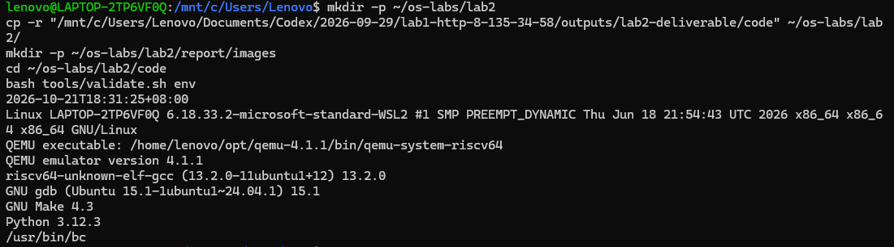
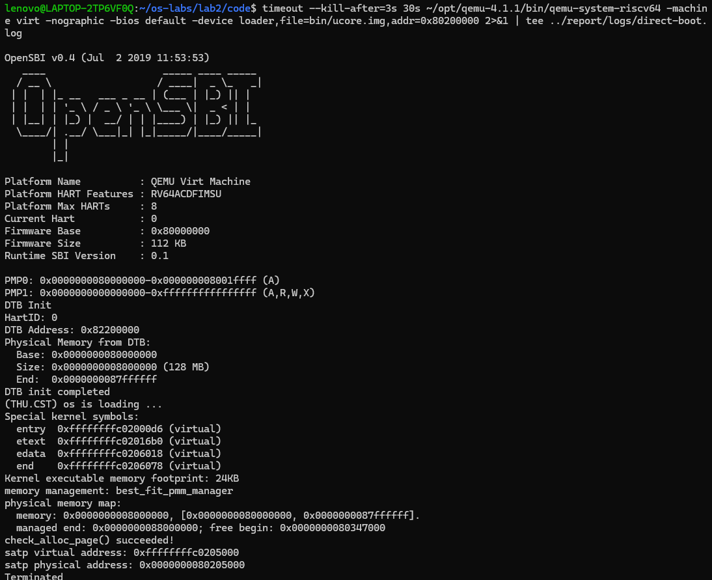
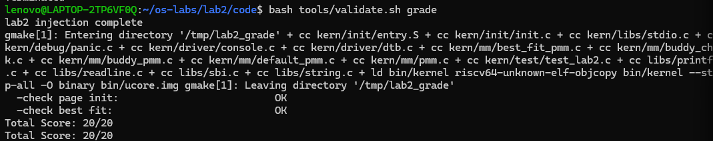
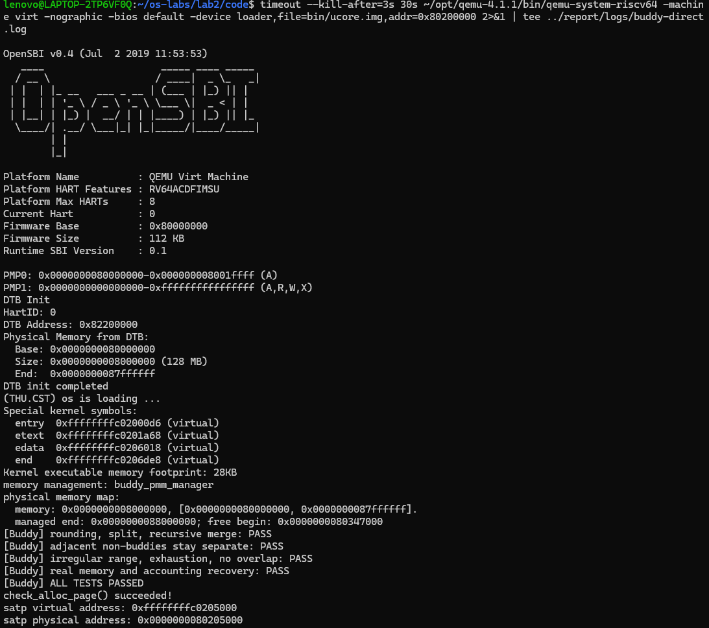
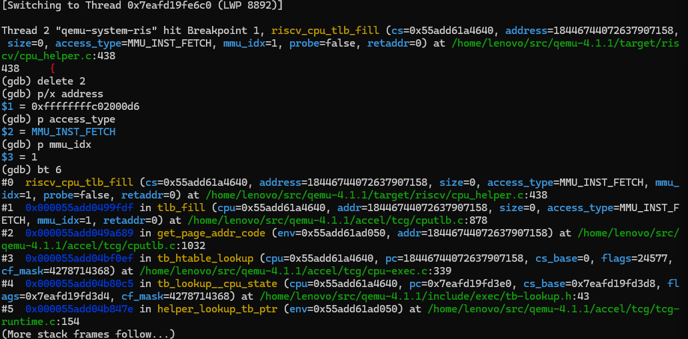
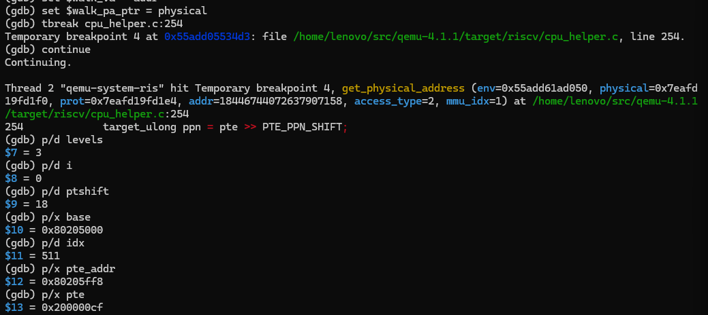
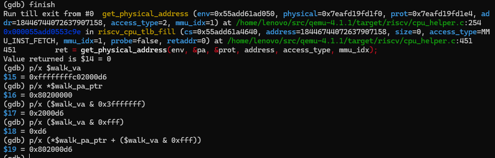
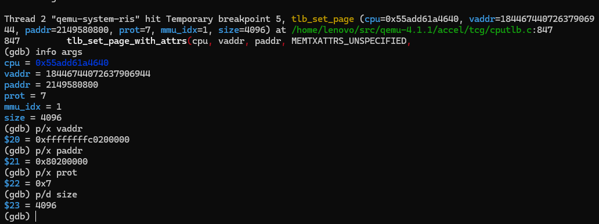
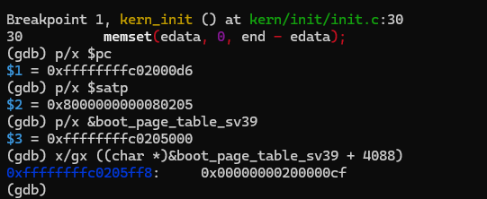
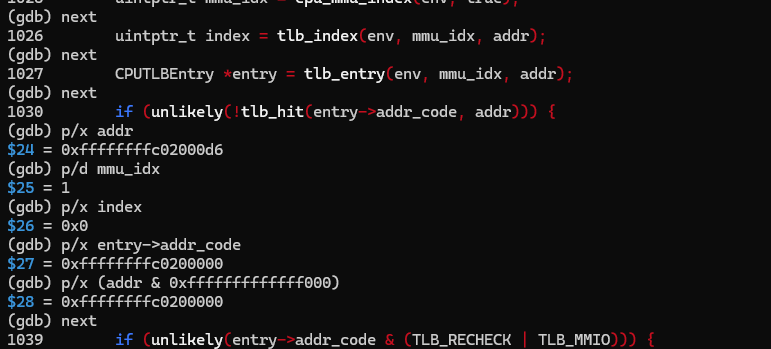

# 操作系统实验报告

## 实验基本信息

| 项目 | 内容 |
|------|------|
| **实验名称** | Lab 2：物理内存和页表 |
| **小组成员** | 2412101-张哲宇、2410683-刘梓涵、2411310-李熔吉 |
| **完成日期** | 2026-10-21 |

### 小组分工

练习如何分工？

| 成员 | 负责的练习/模块 |
|------|----------------|
| 2412101-张哲宇 | page_init、环境与统一接入、最终测试和提交；协助准备 QEMU 调试环境 |
| 2410683-刘梓涵 | Buddy 实现与测试；Sv39 和 QEMU 源码 GDB 分支任务 |
| 2411310-李熔吉 | First-Fit 分析、Best-Fit 实现与分析；协助 Buddy 测试复核、提示词汇总 |

实验报告如何分工？

| 成员 | 报告内容 |
|------|----------|
| 张哲宇 | 环境、物理内存初始化、最终测试与整合 |
| 刘梓涵 | Buddy、页表与 TLB 调试、对应测试解释 |
| 李熔吉 | First-Fit/Best-Fit 分析、提示词和格式核对 |

本报告依据小组本轮实际代码、终端记录与截图编写。QEMU 4.1.1 下 Best-Fit 启动、课程评分 20/20、Buddy 行为测试，以及宿主/客体双 GDB 的页表查询、地址转换、软件 TLB 填充与命中查找均已有实际运行结果。算法辅助检查与客体实测分别记录，不用课程评分代替其他任务证据。

---

## 一、实验目的

1. 从设备树提供的硬件内存信息建立物理页描述符与初始空闲区。
2. 区分虚拟地址、物理地址、物理页号与 Page 指针，理解分页开启后的内存管理。
3. 理解 First-Fit，实现 Best-Fit 和 Buddy，比较连续页分配、碎片与合并策略。
4. 为无现成框架的 Buddy 设计可复现测试，用外部行为和状态不变量验证实现。
5. 使用宿主与客体两层 GDB 理解 QEMU 中的 Sv39 地址翻译及 TLB 行为。
6. 通过明确约束的提示词辅助实现，保留真实迭代与验证证据。

---

## 二、实验环境

| 项目 | 实际环境 |
|------|----------|
| 宿主与 Linux | Windows、WSL 2、Ubuntu 24.04 系列；内核 6.18.33.2-microsoft-standard-WSL2 |
| 目标 | RISC-V 64 位、QEMU virt、默认 128 MB RAM |
| QEMU | 4.1.1，源码编译；/home/lenovo/opt/qemu-4.1.1/bin/qemu-system-riscv64 |
| 交叉编译器 | riscv64-unknown-elf-gcc 13.2.0 |
| 客体调试器 | gdb-multiarch 15.1 |
| Make / Python | GNU Make 4.3 / Python 3.12.3 |
| 固件 | OpenSBI v0.4，Runtime SBI Version 0.1 |
| 实验目录 | ~/os-labs/lab2/code |
| 评分依赖 | bc 位于 /usr/bin/bc |

你们使用的 AI 工具：

| 成员 | AI 编程工具 | 底层模型 | 备注 |
|------|------------|---------|------|
| 张哲宇 | Codex 桌面应用 | 未记录具体型号 | 本轮统一辅助实现、检查与操作指导 |
| 刘梓涵 | 本轮由组长的 Codex 会话统一辅助 | 未单独记录 | 姓名表示分工责任，不表示另有个人 AI 会话 |
| 李熔吉 | 本轮由组长的 Codex 会话统一辅助 | 未单独记录 | 姓名表示分工责任，不表示另有个人 AI 会话 |

AI 工具名称与底层模型版本分别记录，不能只凭工具名推断模型。本轮另外在 Windows MSVC x64 原生适配环境验证分配器算法；该结果与 RISC-V 实测分开记录。

---

## 三、实验整体逻辑分析

### 2.1 本章节的逻辑主线

本实验解决“哪些物理页面可以分配、怎样组织和回收”的问题。每个 Page 描述一页物理内存，空闲块由管理器组织，内核通过统一接口分配和释放。Page 数组是管理元数据，其本身也占用物理内存，不能被分配器再次交出。

### 2.2 功能的逐步实现

1. entry.S 保存启动参数、建立启动页表并开启 Sv39，随后进入 kern_init；DTB 解析提供 RAM 范围。因此 page_init 执行时已经处于分页模式。
2. pmm_init -> init_pmm_manager 选择管理器并初始化内部状态。默认选择 Best-Fit，编译参数 PMM=buddy 可独立选择 Buddy。
3. page_init 校验内存范围、设置地址偏移和描述符布局，保留固件/内核/元数据，将剩余完整页面通过 init_memmap 注册。
4. alloc_pages/free_pages 通过管理器回调分配、拆分、回收和合并；nr_free_pages 反映空闲物理页数。
5. 运行框架检查、课程评分及 Buddy 自设计测试；GDB 分支进一步从模拟器实现观察地址翻译。

---

## 四、实验内容与实现

### 功能模块一：物理内存初始化

**负责人：** 2412101-张哲宇。

#### 模块功能描述

```c
static void page_init(void);
```

实现位于 kern/mm/pmm.c，保留 lab2 function1 标记并填写学号。读取设备树 base/size，拒绝零长度、溢出和不受当前固定启动映射支持的基址；将管理终点限制在 PHYSICAL_MEMORY_END 后向下按页取整。固定映射和 nbase 基于 DRAM_BASE，本实现不声称支持任意硬件内存布局。

设置 va_pa_offset=PHYSICAL_MEMORY_OFFSET；npage 是管理上界的物理页号，描述符数量为 npage-nbase。pages 在链接符号 end 后按 4 KiB 对齐，先检查整个描述符数组能放入可管理内存，再将所有描述符置为保留、引用计数为零。

空闲起点等于描述符数组物理结束位置向上按页取整。只有起点小于管理终点时才调用 init_memmap，因此 OpenSBI、内核镜像、元数据及不完整页面均不进入空闲区。

本次 Best-Fit 实测与布局推导：

| 项目 | 数值与依据 |
|------|------------|
| DTB RAM 范围 | [0x80000000, 0x88000000)，128 MB，实测 |
| nbase / npage | 0x80000 / 0x88000，按页号推导 |
| 描述符数 | 32768，npage-nbase |
| 内核 end | VA 0xffffffffc0206078，实测 |
| 描述符起点 | PA 0x80207000，按页对齐推导 |
| 描述符大小 | RV64 ABI 下 struct Page 为 40 字节，数组共 0x140000 字节 |
| 空闲起点 | PA 0x80347000，运行输出与推导一致 |
| 初始空闲页数 | 31929，由终点与空闲起点的差除以 4096 推导 |

#### 最终提示词

完整记录见 prompt.md 的 P1，本模块最终任务规格为：

```text
阅读 pmm.c/pmm.h、memlayout.h、dtb.c、entry.S 和课程测试，实现 page_init。
保留 lab2 标记并填写 2412101；读取 DTB base/size，检查无效范围和溢出，
按固定映射设置 va_pa_offset，正确区分 npage 与 npage-nbase。
裁剪管理上界、向下按页对齐终点；在 end 后按页对齐放置 Page 数组并检查容量。
描述符先全部保留，排除固件、内核和描述符占用，向上对齐空闲起点。
仅在存在完整空闲页时调用 init_memmap；无效设备树必须 panic。
禁止修改测试，不把 page_init 描述为首次开启 Sv39。
```

#### 实现迭代过程

本轮先阅读代码与评分约束，再实现函数。用户在 QEMU 4.1.1 上实际编译和启动成功，课程 page init 检查为 OK。初版验证脚本未捕获启动输出，直接启动同一镜像后成功；这是需要修复的验证流程问题，未据此伪造内核失败或通过。脚本修订和复核情况见测试章节。

### 练习：硬件可用物理内存范围获取方法（Challenge 思考题）

**负责人：** 2412101-张哲宇。

OS 可以从启动固件或引导程序提供的硬件描述获取内存布局：本实验采用 RISC-V DTB 的 memory 节点，其他平台可能采用 UEFI 内存映射或 BIOS E820。需要同时识别保留区域、MMIO 与固件占用，并在启用分配前验证范围、溢出和对齐。设备树描述的是硬件内存资源，仍需扣除内核自身占用；盲目读写未知地址可能触发异常或设备副作用，不能作为通用发现方法。本节是分析回答，未声称新增硬件探测实现或已获得加分。

### 功能模块二任务一：理解 First-Fit

**负责人：** 2411310-李熔吉。

default_init 初始化空闲链表头并清零 nr_free。default_init_memmap 清除新注册页面的保留状态，重置引用计数，在首描述符记录块长度，按地址放入链表，并增加空闲页总量。

default_alloc_pages 从链表头查找第一个长度不小于请求的块。整块满足时删除节点；块较大时分出请求前缀，把剩余尾块放回原位置。清除已分配首块的 PageProperty，扣除实际交出的页数。

default_free_pages 重置回收页面状态，按地址插入空闲链表。先检查前块末端是否等于当前块起点，再检查后块是否紧接合并后的末端；符合条件才合并，撤掉不再作为首块的节点和标记。地址有序使“相邻链表节点”成为检查候选，但必须进一步验证物理连续。

**改进空间：**线性遍历可用分桶或索引减少搜索，但需权衡维护成本；可增加 Next-Fit 搜索游标或针对常见大小建立快速路径。回收时及时合并减少外部碎片，但连续分配仍会受到外部碎片影响，不能保证总空闲足够就一定成功。

### 功能模块二任务二：实现 Best-Fit

**负责人：** 2411310-李熔吉。

#### 模块功能描述

```c
static void best_fit_init(void);
static void best_fit_init_memmap(struct Page *base, size_t n);
static struct Page *best_fit_alloc_pages(size_t n);
static void best_fit_free_pages(struct Page *base, size_t n);
static size_t best_fit_nr_free_pages(void);
```

补齐 best_fit_pmm_manager 与全部回调。内部 free_area 的 free_list/nr_free 与框架测试约定一致，链表按地址组织；分配扫描满足请求的所有候选，选择最小块，同大小保留较低地址候选，遇到精确匹配可提前结束。拆分后只保留尾块空闲标记，释放后通过 insert_free_block 检查前后合并。分配与释放分别扣减、增加请求页数。

basic_check() 和 best_fit_check() 完整保留，已与压缩包正文比较确认未修改。pmm.c 默认选中 best_fit_pmm_manager，避免“写好模块却仍运行 First-Fit”的错误。

**改进空间：**当前查找为 O(k)，k 为空闲块数；可增加按块大小索引的平衡树、大小桶等，同时保留地址索引用于合并。Best-Fit 降低本次分配余量，不保证所有负载下外部碎片最少，也可能产生很多小块；需要结合工作负载评估。

#### 最终提示词

完整记录见 prompt.md 的 P2，本模块最终任务规格为：

```text
参考 First-Fit 与 pmm_manager，补齐 best_fit_pmm.c 全部管理函数和注册结构。
保留 basic_check/best_fit_check 原文，状态应兼容 free_list/nr_free 约定。
空闲块按地址组织，扫描选择最小可容纳块，同大小优先低地址，精确匹配可退出。
维护精确分配、尾块拆分、按地址回收和前后合并，以及 flags/property/ref/计数。
保留 lab2 标记并填写 2411310，默认管理器选 Best-Fit；回答改进空间。
```

#### 实现迭代过程

补齐实现后，原生适配测试通过保留的框架检查和 10000 次混合操作。用户随后在 Ubuntu 使用课程原始 loader 参数启动，输出 memory management: best_fit_pmm_manager 和 check_alloc_page() succeeded!；make grade 实际得到两个 OK、20/20。

### 功能模块二任务三：Buddy System

**负责人：** 2410683-刘梓涵。

#### 模块功能描述

新增 buddy_pmm.c/.h 与 buddy_check.c。每阶维护空闲链表，块大小为 2 的幂页，按物理页号对齐，伙伴页号由 PPN XOR 块页数求得。初始非对齐区间拆成多个合法块；分配从足够大的阶开始寻找，逐级拆分；释放时只与同阶且空闲的正确伙伴合并。

```c
static void buddy_init(void);
static void buddy_init_memmap(struct Page *base, size_t n);
static struct Page *buddy_alloc_pages(size_t n);
static void buddy_free_pages(struct Page *base, size_t n);
static size_t buddy_nr_free_pages(void);
void buddy_check(void);
```

本框架管理上界对应 32768 页，因此最高阶为 15。非 2 的幂请求向上取整，如请求 3 页实际占用 4 页。分配首描述符记录原请求长度，专用 flags 位标记分配首块，ref 仍是引用计数。free_pages 必须传原请求页数且整块释放，不支持随意释放其中一部分。nr_free_pages 扣减和增加实际块大小，因此与 Best-Fit 的精确 n 页语义不同；接口允许分配不少于 n 页，报告明确这一约定。

通过 make PMM=buddy 独立启用，切换前 make clean。默认配置仍为 Best-Fit；不在活跃分配状态下直接替换管理器。

#### 最终提示词

实现与接入规格见 prompt.md 的 P3：

```text
从零实现 Buddy 并接入 pmm_manager，责任模块 2410683。使用每阶空闲链表，
按物理页号对齐，伙伴按 PPN XOR 块大小定位；支持不规则初始区间分解。
分配向上取 2 的幂并逐级拆分，释放仅合并合法同阶空闲伙伴。
最高阶对应当前固定上界；记录原请求但不占用 ref 的引用计数用途。
free_pages 使用原请求 n，回收完整取整块，检查分配首地址和请求长度。
统计实际占用页数，提供独立 PMM=buddy 配置，默认仍保持 Best-Fit。
```

针对生成实现的测试规格见 prompt.md 的 P4：

```text
另建测试源文件，通过接口检查具体 Buddy 实现，不能只复用内部公式。
覆盖非 2 的幂请求、逐级拆分、递归合并、相邻但非伙伴块、不规则初始区间、
耗尽及超上限请求、不重叠、不进入保留区、释放后统计恢复。
隔离区与真实物理页区分别测试，解释恢复初始状态的前提。
每类断言成功后才打印 PASS，说明这些行为能发现哪些错误及未覆盖的范围。
```

#### 实现迭代过程与测试有效性

先实现管理器，再通过独立源文件检查外部行为：3 页请求导致空闲数减少 4，验证向上取整；释放后能重新分配 32 页，验证拆分后多级合并；只注册页号相邻但非伙伴的两页，断言 2 页分配失败，排除“任意相邻都合并”的错误。

注册起始偏移 3、长度 61 的隔离区，逐页耗尽并检查地址唯一、边界和保留标记，交错释放后验证统计恢复与 32 页块可用；超出剩余总量或最大阶数的请求返回 NULL。真实空闲区再验证不同大小分配、对齐、两两不重叠和全部释放后计数恢复。

隔离测试暂时替换描述符视图，完成后恢复真实视图并重建初始单一连续空闲区。本框架 page_init 只注册一个连续空闲区，这是该检查恢复过程的前提，不声称支持任意多个初始空闲区的原样快照恢复。测试尚未覆盖所有非法输入导致的 panic 分支或并发。

QEMU 4.1.1 实际输出四组 PASS、[Buddy] ALL TESTS PASSED、check_alloc_page() succeeded!，与原生适配结果一致。

### 分支任务：GDB 调试页表查询过程

**负责人：** 2410683-刘梓涵；张哲宇协助环境。

已在独立 qemu-4.1.1-debug-build 目录使用 --enable-debug、--target-list=riscv64-softmmu、--disable-werror、--disable-docs 和 Python 3 配置并编译成功。configure 显示 CFLAGS=-g、TCG debug enabled yes；file 显示 x86-64、with debug_info、not stripped。保留原安装版，无需覆盖安装。宿主和客体分别使用一个 gdb-multiarch 实例；宿主根据 QEMU ELF 自动采用 x86-64，客体显式设置 riscv:rv64，不能把两个调试目标混淆。

静态源码已核对 QEMU v4.1.1：target/riscv/cpu_helper.c 包含 get_physical_address 和 riscv_cpu_tlb_fill；后者调用前者并在成功后调用 tlb_set_page。accel/tcg/cputlb.c 的 load_helper/store_helper 检查 TLB，未命中时可能尝试 victim TLB 或进入 tlb_fill，再调用架构回调；TCG 生成的快速访存路径也需结合源码说明，不能把 C 慢路径当成每次访存必经路径。

宿主 GDB 已实际附加到 QEMU 进程，设置条件断点 riscv_cpu_tlb_fill if (address >> 12) == 0xffffffffc0200。客体 GDB 继续运行后，宿主在取指填充路径命中，access_type=MMU_INST_FETCH、mmu_idx=1。随后通过临时断点进入 get_physical_address，实测 env->satp=0x8000000000080205、env->priv=1，确认 Sv39 与 S 模式。

在 cpu_helper.c:254、PTE 读取之后暂停，实测 levels=3、i=0、ptshift=18、base=0x80205000、idx=511、pte_addr=0x80205ff8、pte=0x200000cf。根页表项地址等于 base+511*8。PTE 的 V/R/W/X/A/D 置位，是根层叶子，对应 1 GiB 大页，因此本次查询不需要继续下降两层。

待翻译 VA 为 0xffffffffc02000d6。get_physical_address 返回码为 0，写出的 physical 是 0x80200000。这里函数输出为 4 KiB 物理页基址，不包含最低 12 位字节偏移；结合 VA&0xfff=0xd6，物理字节地址为 0x802000d6。另一种等价推导为大页物理基址 0x80000000 加 1 GiB 页内偏移 0x2000d6。不能把 physical=0x80200000 误判为翻译失败。

随后宿主在 tlb_set_page 实测 vaddr=18446744072637906944（0xffffffffc0200000）、paddr=2149580800（0x80200000）、prot=7、mmu_idx=1、size=4096。prot 是 QEMU 内部 PAGE_READ/WRITE/EXEC 权限位，不能直接当成 RISC-V PTE 编码。当前架构回调按 4 KiB 粒度交给软件 TLB，和页表本身使用 1 GiB 大页并不矛盾。这一步动态记录了填充入口参数，后续命中查找则进一步验证条目确已可用。

宿主继续运行后，客体在 kern_init 命中硬件断点，PC=0xffffffffc02000d6、satp=0x8000000000080205、&boot_page_table_sv39=0xffffffffc0205000。读取根表 VA+4088（第 511 项）得到 0x200000cf，与宿主读取结果一致。satp 的 PPN 左移 12 位得到 PA 0x80205000，和根表 VA 减 PHYSICAL_MEMORY_OFFSET 的结果一致。此处是两个调试器的动态交叉核对，不再仅依赖内核运行打印值。

最后在宿主给 get_page_addr_code 设置同页条件断点，在客体执行 si。宿主命中后逐行执行至 cputlb.c:1030，实测 addr=0xffffffffc02000d6、mmu_idx=1、index=0、entry->addr_code=0xffffffffc0200000；访问地址按 4 KiB 对齐后也为 0xffffffffc0200000。再次 next 直接来到第 1039 行，跳过 1031-1036 行的 victim TLB/填充处理，证明本次软件 TLB 查找命中。这是取指路径的一次动态观察，不外推为所有数据读写或所有访问都命中。

这条路径先按 MMU 索引与地址定位槽位，再用取指标签和访问页地址进行匹配；未命中时才尝试 victim TLB 或架构翻译回调。命中后还会检查 TLB_RECHECK/TLB_MMIO，普通 RAM 路径使用 addr+entry->addend 得到宿主访问指针，并转换为 QEMU RAM 地址。addend 和函数返回的 RAM 地址属于模拟器内部表示，不能当作客体物理地址；报告中的 VA->PA 数值来自前面的架构翻译函数。

Bare 模式在适用特权和访问条件下不进行 Sv39 多级页表翻译，但不能据此断言 QEMU 完全不使用软件 TLB：后者还服务于宿主内存访问、权限及 RAM/MMIO 路径。真实 CPU 的硬件 TLB 缓存地址翻译，而 QEMU 软件 TLB 在模拟器中还保存宿主访问所需的信息，二者不是同一个结构。M 模式和 MPRV 等条件也影响翻译路径，不能只看 satp 就概括所有访问。

调试问题如实记录：首次条件断点长命令被终端换行截断，改用页号右移比较解决；重复设置的同址断点通过 delete 2 清理；系统库 ppoll.c 缺失只影响系统库源码显示，不影响 QEMU 源码调试。指导过程中曾预期 helper 直接输出完整字节 PA，实测和源码表明应区分页基址与页内偏移，已据实纠正。

### Challenge：SLUB

未实现，不声称完成或已获加分。其核心是在页级管理器上建立对象缓存和页内空闲对象管理，从而支持小于一页的不同大小对象；本实验的已实现部分仍为页级分配。

---

## 五、测试与验证

| 检查 | 实际状态 | 能证明的范围 |
|------|----------|--------------|
| 环境版本 | 已收到 Ubuntu 输出 | QEMU 4.1.1、GCC/GDB/Make/Python 和 bc 可用 |
| 干净编译与 Best-Fit 启动 | 已通过 | RISC-V 内核启动、DTB 初始化、默认 Best-Fit 框架检查 |
| make grade | 20/20 | 脚本中的 Page Init 与 Best-Fit 检查 |
| Buddy 独立镜像 | 四组 PASS，总检查通过 | 当前自设计测试覆盖的行为与边界 |
| Windows 原生算法检查 | 已通过 | 真实分配器源文件的算法行为，不包含硬件启动 |
| 修订后的 validate.sh | 已在 Ubuntu 复核通过 | 非交互启动、30 秒超时和默认 Best-Fit 恢复 |
| 双 GDB 分支 | 页表查询、地址转换、TLB 填充、客体交叉核对与取指 TLB 命中均已实测 | 页表层级、页基址/字节地址及缓存路径 |
| 截图归档 | 四张基础截图已复制并检查 | 环境、Best-Fit、课程评分和 Buddy |

已收到的课程评分输出：

```text
  -check page init:                          OK
  -check best fit:                           OK
Total Score: 20/20
```

已收到的 Buddy 输出：

```text
[Buddy] rounding, split, recursive merge: PASS
[Buddy] adjacent non-buddies stay separate: PASS
[Buddy] irregular range, exhaustion, no overlap: PASS
[Buddy] real memory and accounting recovery: PASS
[Buddy] ALL TESTS PASSED
check_alloc_page() succeeded!
```

**测试截图：**

环境版本：



Best-Fit 编译后的直接启动结果：



课程评分：



Buddy 独立运行：



宿主进入 TLB 填充路径：



根层大页页表查询：



翻译结果：



TLB 填充参数：



客体侧交叉核对：



TLB 命中查找：



原生检查日志见 logs/host-algorithms.log。Ubuntu 环境、构建、直接启动、课程评分及宿主 GDB 日志已从操作者目录汇总到 logs/。其中 buddy.log 保留初版脚本无固件输出的失败记录，成功的 Buddy 运行应查看 buddy-direct.log；不将失败日志冒充成功结果。

初版脚本在嵌套管道中运行 QEMU 时未捕获固件输出，直接启动同一镜像则成功。修订为直接调用 QEMU、stdin=/dev/null、30 秒超时并移除外层函数管道后，操作者再次干净构建并运行 Best-Fit，实际出现固件与内核输出、check_alloc_page 成功和默认管理器名称，脚本正常返回。现象支持修订有效，但未单独隔离每项改变的因果关系，不断言已严格证明底层根因。超时结束常驻内核本身不是失败，通过条件仍是实际检查标志且无 panic。

---

## 六、实验总结与收获

### 对操作系统的理解

1. 物理页描述符是 OS 的管理数据，物理页面是资源本身；描述符索引加 nbase 得到物理页号，不能把 Page 指针直接当作 PA。
2. 地址翻译和物理页分配是两件相互配合的工作：Sv39 负责访问地址如何映射，分配器负责哪些物理页空闲。page_init 不等于首次开启分页。
3. First-Fit/Best-Fit 面临外部碎片；Buddy 用对齐的幂次块简化拆分合并，但向上取整产生内部碎片。统计总空闲页不等于保证任何连续请求成功。
4. 固件保留、内核镜像和元数据占用体现了资源所有权约束；对齐、边界和不变量与核心算法同样重要。
5. 本实验未覆盖完整多进程地址空间、缺页异常和页面置换、用户态隔离、NUMA/并发分配、完整对象缓存等机制，不能把最小实现等同于生产级内存管理。

### AI 协作开发的经验

提示词必须提供真实接口、保留区和测试约束，不能只要求“实现某算法”。无框架任务需要先固定分配/释放契约，再生成针对该契约的测试。原生算法测试、客体启动、课程评分与源码调试证明不同层面的性质，不能互相替代。遇到无输出时应先区分构建、启动脚本和内核，再定位问题；所有最终结论以真实运行和证据为准。
